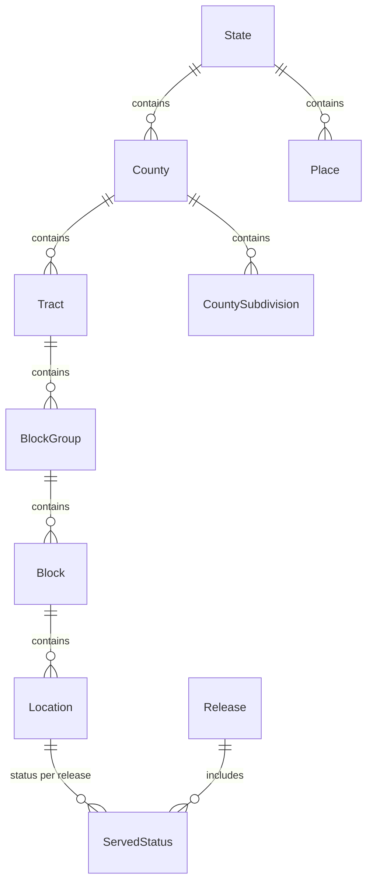

# 0006 — Data model for locations and boundaries

- **Status:** Accepted
- **Date:** 2026-10-14

## Context

The FCC Served/Unserved file has no geometry. It identifies each location by a
2020 census block GEOID (`block_geoid`) and an H3 resolution-8 cell
(`h3_res8_id`), and it carries three 100/20 Mbps flags per location. The Ohio
file has 4,542,350 rows. Boundary polygons come from the Census Bureau's
TIGER/Line 2020 files ([0005](0005-census-tiger-2020-boundaries.md)).

[0001](0001-start-with-ohio-served-unserved.md) asks for a schema that takes
new data categories, filing periods and states without reworking the
Served/Unserved pipeline.
[0002](0002-django-for-api-and-data-model.md) makes each data category its own
Django app.

This decision covers the tables and the rules they enforce
([#20](https://github.com/ShawnMcCollum/BroadbandMap/issues/20)). The loader
that fills them is separate
([#21](https://github.com/ShawnMcCollum/BroadbandMap/issues/21)).

## Decision

1. **One table per boundary level, sharing an abstract base model.** Each level
   has its own parent, GEOID length and extra fields: a block carries
   population, housing units and an urban/rural class, and a state carries an
   abbreviation. Separate tables give each level typed columns and real
   foreign keys. The base model holds what every level shares: name, land and
   water area, internal point and geometry.
2. **The Census GEOID is the primary key of each boundary table, and foreign
   keys hold the parent's GEOID.** The FCC file already carries `block_geoid`,
   so locations join to blocks without a lookup. A GEOID starts with its
   parent's GEOID, so a rollup can group by prefix without joins. A check
   constraint on each table requires a GEOID of exactly the right length, all
   digits.
3. **Geometry is stored in WGS84 (SRID 4326).** The TIGER/Line files are NAD83
   (EPSG:4269), but web maps and GeoJSON use WGS84, and one SRID avoids a
   transform in every query. The loader converts from NAD83.
4. **Seven boundary levels are modelled now:** state, county, census tract,
   block group, census block, place and county subdivision. Places and county
   subdivisions are matched to locations by spatial join, not by GEOID
   prefix. ZCTA is left out until it is loaded: its download is opt-in
   ([0005](0005-census-tiger-2020-boundaries.md)), and a ZCTA can cross state
   lines, so it does not fit the parent chain.
5. **`Location` is separate from `ServedStatus`, which is stored per
   `Release`.** A location's block and H3 cell rarely change between filing
   periods; its status can. Storing each once means a new period adds status
   rows but no new locations. The FCC reprocesses a filing period (the `D25`
   file is stamped `29sep2026`), so one period can have several versions. A
   `Release` is one version and is unique on its `as_of` and `processed_on`
   dates. In every row the three flags are nested (wired implies terrestrial,
   which implies any), and check constraints enforce it.
6. **Three Django apps, following 0002:** `geography` for boundaries, `bdc`
   for releases and locations, and `served_unserved` for status. Releases and
   locations belong to the FCC Broadband Data Collection as a whole, so a
   later data category can reuse them.
7. **The Django admin is read-only for every model.** Only the loader writes
   this data, so an edit in the admin would drift from the source files.
   Lists show parent IDs and leave out geometry, and a boundary's change page
   summarizes its geometry instead of printing the full WKT. Location search
   uses exact, indexed lookups, because the table has 4.5M rows.
8. **Foreign keys use `PROTECT`, except `ServedStatus` to `Release`, which
   uses `CASCADE`.** Deleting a boundary or a location that still has
   dependent rows is an error, not a silent loss of millions of rows. Deleting
   a release is how a bad load is undone, so it removes that release's
   statuses.
9. **Ruff ignores `RUF012` in `models.py`, `admin.py` and migrations, and
   `E501` in migrations.** `RUF012` flags mutable class attributes such as
   `Meta.constraints` and `list_display`, which Django expects. Migrations are
   generated, and their long lines are not worth wrapping.

## Alternatives considered

- **One boundary table with a `level` column.** Fewer tables, but the
  level-specific fields would be mostly empty, and a foreign key could not
  point at one level.
- **Surrogate integer keys.** Narrower keys, but the loader would map every
  GEOID to an id, and queries would join to get the GEOID back.
- **Storing NAD83.** Matches the source files and needs no conversion at load
  time, but every map output would transform the geometry.
- **One flat location table holding the flags.** The simplest shape, but each
  release would repeat or overwrite the location rows, and comparing periods
  would be awkward.
- **Django 5.2 composite primary key for `ServedStatus`.** It matches the
  natural key, but the admin and Django REST Framework do not support it yet.
  A unique constraint on the pair does the same job.
- **Two apps.** Fewer apps, but locations and releases would sit with
  Served/Unserved status, against the one-app-per-category rule in 0002.
- **An editable admin with a map widget.** The data is owned by the loader, and
  the widget would load a county's full geometry into every change page.

## Consequences

- **Positive:** New levels, filing periods and data categories are additive: a
  new table or app, with no change to the existing ones.
- **Positive:** Rollups can group by GEOID prefix without joins.
- **Negative:** `ServedStatus` is a second table of about 4.5M rows, and each
  further release adds as many again.
- **Negative:** Load order matters: boundaries first, then locations, then
  statuses. Foreign keys are checked at commit, so a missing parent shows up
  at the end of a load, not at the bad row.
- **Follow-up:** #21 loads the boundaries and locations. Rollups are #22.
